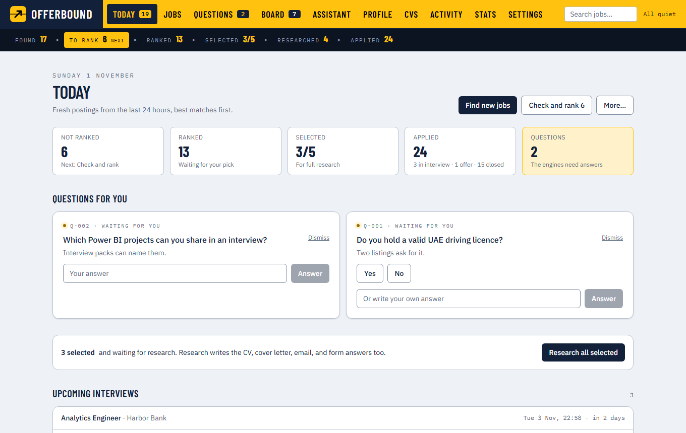
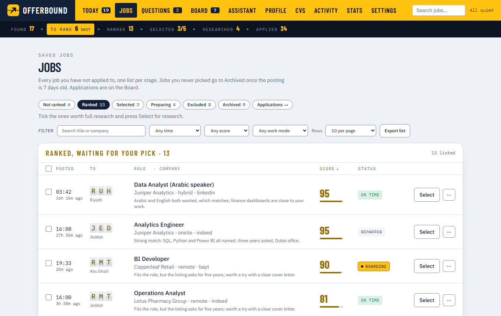
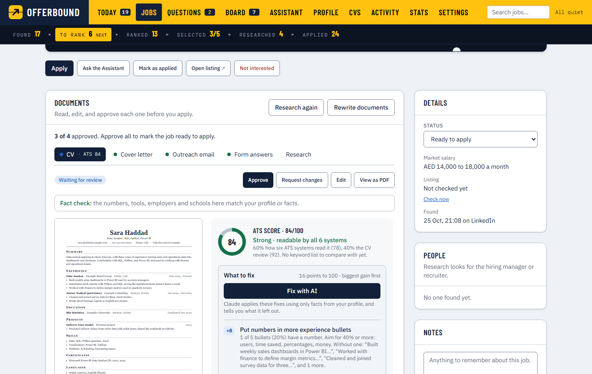
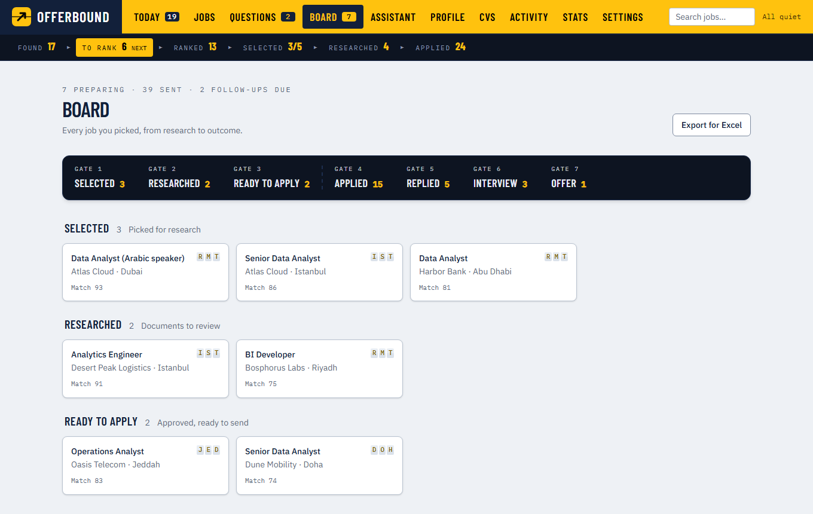
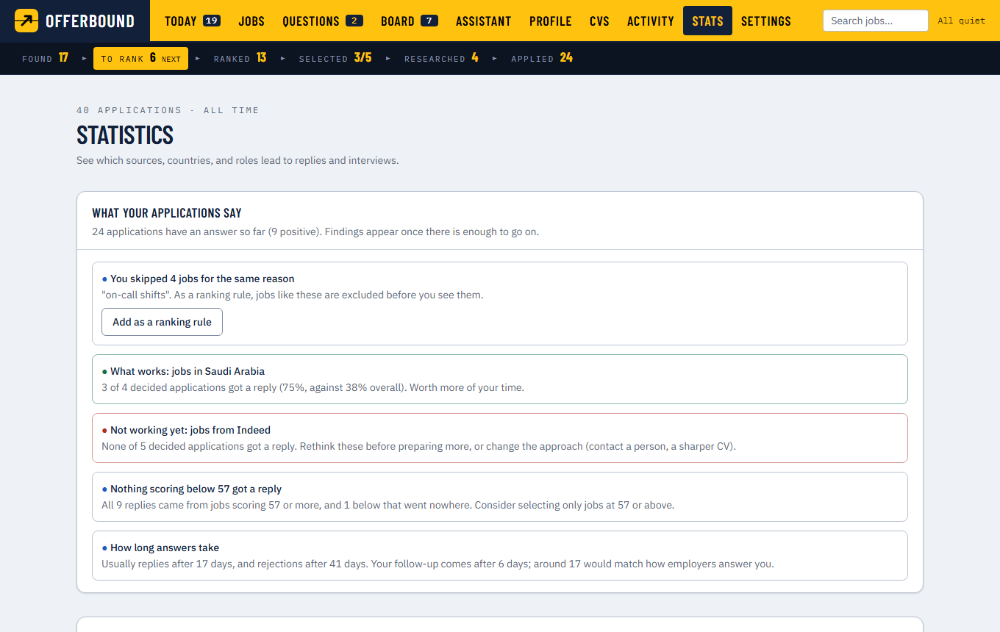
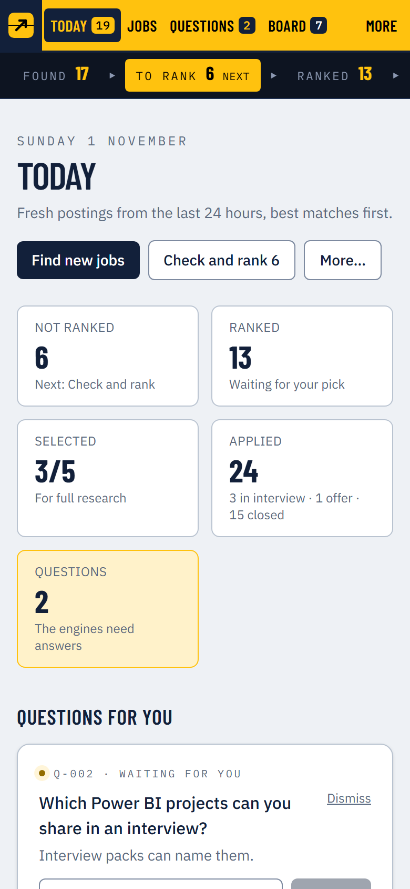

# Offerbound

Finds fresh job postings, ranks them against your CV, writes a tailored CV, cover letter and email for the ones you pick, helps you fill the application forms, and tracks every application until it ends. The AI work is done by Claude Code (or Codex) on your own computer with your own subscription; a local web app is where you control it.

Everything runs on your computer. Your CV, your jobs and your history stay in this folder; they leave it only when the AI engine reads them to do a step (sent to Anthropic or OpenAI under your own plan).

**It never sends or submits anything for you.** Every application and every email is sent by you pressing Submit or Send.



<sub>Screenshots show a demo with a fictional candidate and fictional companies.</sub>

**New here?** Follow the [getting-started guide](docs/GETTING-STARTED.md): every step from installing Node.js to your first application, with pictures.

## What you need

- [Node.js](https://nodejs.org) 22.13 or newer
- One AI engine with your own plan:
  - **Claude Code** (Claude Pro or Max): `npm install -g @anthropic-ai/claude-code`
  - or **Codex** (a ChatGPT plan): `npm install -g @openai/codex`
- Chrome, Edge or Firefox, for the Offerbound browser extension

Works on Windows, macOS and Linux.

## Install

Get the folder (`git clone`, or download and unzip it), open a terminal in it, and run:

```
npm run setup
```

This installs the app and downloads a small browser engine (about 150 MB) that turns your CVs and cover letters into PDF files.

Then, once, let your engine work in this folder:

- Claude Code: run `claude` in this folder, sign in if asked, accept the prompt to trust the folder, then type `/exit`.
- Codex: run `codex` in this folder, sign in, trust the folder, then exit.

## Getting started

Run these in a terminal opened in the Offerbound folder: **PowerShell** or **Windows Terminal** on Windows, **Terminal** on macOS, your usual terminal on Linux. The commands are the same on all three.

### Choose how to run it

| | Start | Stop | Good for |
|---|---|---|---|
| **In a terminal** | `npm start` | Ctrl+C, or close the terminal | Trying it out; running it only when you need it |
| **In the background** | `node scripts/service.mjs start` | `node scripts/service.mjs stop` | Daily use: no window to keep open, and it starts again if it ever stops |
| **For development** | `npm run app` | Ctrl+C | Working on Offerbound's code (reloads as you edit) |

Then open **http://localhost:3000**. The first start builds the app (a minute or two); later starts are quick. The **Setup** screen walks you through the rest: check the engine, upload your CV, add facts the CV does not say, choose countries, roles and keywords, and build your profile. Then go to **Today** and press **Find new jobs**.

### Make it feel like an app (optional)

- **Start when you sign in:** `node scripts/service.mjs autostart on` (or the switch in **Settings → This computer**). It uses the usual place on each system, for your user only, without administrator rights:

  | System | Where it goes |
  |---|---|
  | Windows | The sign-in list in the registry (*Startup apps* in Windows settings), started without a window |
  | macOS | A LaunchAgent in `~/Library/LaunchAgents` |
  | Linux | A desktop autostart entry in `~/.config/autostart` (GNOME, KDE, Xfce and others) |

  `node scripts/service.mjs autostart off` removes it.
- **Its own window:** install it from the browser: **Settings → This computer → Install Offerbound**, or the install icon at the right of the address bar in **Chrome** or **Edge** (Windows, macOS, Linux). On a Mac, **Safari** can do it too: File → Add to Dock. It then has its own window, a taskbar or Dock icon and an entry in the Start menu, Launchpad or app list. Firefox cannot install sites as apps; use it in a tab.
- **The other commands:** `node scripts/service.mjs status`, `restart`, `update` (gets the latest version and restarts) and `logs` (why it stopped, if it did).

### Off until you turn it on

Nothing runs by itself, opens to your network or reads your mail until you choose it:

| Feature | Where to switch it on |
|---|---|
| A password to open Offerbound (on this computer and other devices) | Settings → This computer |
| Start at sign-in | Settings → This computer, or `autostart on` |
| Searching on a schedule (and checking whether listings are still open) | Settings → Schedule |
| Opening it on your phone over home Wi-Fi | Settings → Other devices |
| Watching Gmail for replies | Settings → Email |
| Job sites read in your browser (Indeed, Bayt and others) | Settings → Sources |

Old, unpicked postings are moved to the archive after 7 days to keep the lists short (Settings → Freshness; nothing is deleted, and 0 turns it off).

## The screens

| Screen | Purpose |
|---|---|
| Today | What needs you now: fresh jobs, replies, follow-ups and thank-you notes due, listings that closed, the jobs you picked |
| Jobs | Every job not yet applied to, one table per stage (not ranked, ranked, selected, preparing, excluded, archived) |
| Board | Your applications, stage by stage, with replies and outcomes |
| Questions | Gaps in your CV, facts about you, and questions about single jobs |
| Assistant | Chat with the engine about your jobs |
| Profile | Facts about you, extra ranking rules, the profile built from your CV |
| CVs | CV templates, your base CV for each role, and every tailored CV and cover letter (with an ATS check) |
| Activity | Every step that has run, with live progress |
| Stats | What works: replies and interviews by source, country, role, score and speed, and patterns in your answers |
| Settings | Countries, roles, sources, schedule, engines, email, colours, other devices |

On a phone the top bar shows Today, Jobs, Board and Questions; the rest and search are under **More**.

| | |
|---|---|
|  |  |
| **Jobs** — every saved job, one table per stage | **A job** — the tailored CV with its fact check and ATS score |
|  |  |
| **Board** — your applications, gate by gate | **Stats** — what works, from your own answers |

<p align="center"></p>

## A job's way through

1. **Find** — LinkedIn and Workable are searched without logging in, in your countries' order. Sites that block automated access (Indeed, Bayt, GulfTalent, Naukrigulf, Kariyer.net and more) are read in your own browser by the extension.
2. **Rank** — each job gets a score and a short reason from your profile and rules. Jobs you never pick go to the archive after a week (Settings → Freshness).
3. **Select and research** — tick the jobs worth it; research writes notes on the company and the people, then the tailored CV, cover letter, outreach email and form answers.
4. **Review** — read and approve each document. A fact check lists anything the documents claim that your CV and facts do not back, and the ATS check shows how application systems read the CV.
5. **Apply** — the extension opens the form, fills every step and attaches the PDFs; you check it and press Submit. Or send the email application from Gmail.
6. **Track** — replies in your Gmail are matched to the application; follow-ups, check-ins and thank-you notes are suggested at the right time. Offerbound also checks whether a listing has closed.

## The Offerbound extension (Chrome, Edge, Firefox)

Settings → Sources shows the steps for your browser:

- **Chrome or Edge:** open `chrome://extensions` (or `edge://extensions`), switch on Developer mode, press **Load unpacked**, and choose the `extension` folder.
- **Firefox:** open `about:debugging#/runtime/this-firefox`, press **Load Temporary Add-on…**, and choose `manifest.json` in the `extension` folder. Firefox removes it when it closes, so repeat this after a restart.

Then press **Connect** in Settings → Sources and confirm in the small window that opens. Only your own Offerbound can then use it.

What it does:

- **Collect in your browser** — reads the sites that block automated access, a few pages per site, at a person's pace, in a minimized window. A captcha or robot check stops it for that site; it never tries to get around one.
- **Fill application forms** — on the job's own site only; LinkedIn is never automated.
- **Gmail** (Settings → Email, off until you switch it on) — reads your unread inbox with your browser's own Gmail session (no password, no Google sign-in for Offerbound) every 15 minutes, and keeps only the emails about your applications. Follow-ups open in Gmail's compose window, filled in; you press Send.
- **Indeed listings** — checks whether they are still open, in your browser.

## Your phone

Settings → Other devices: on your home Wi-Fi (switch it on, then scan the code with the phone once), or from anywhere through [Tailscale](https://tailscale.com) (free for personal use). The app itself only listens on your computer; other devices need the one-time pairing code or link from that screen.

## Schedule

Settings → Schedule (off until you turn it on) checks for fresh postings every few minutes during the hours you choose and ranks new ones at once, and runs a full search once a day. It works while the app is running, so it pairs well with running it in the background.

## Your data

`candidate/` (CV, facts, profile), `jobs/` (one folder per job) and `data/` (the database) are private and are never part of the shared project. To back up or move to another computer, stop the app and copy those three folders. `docs/Offerbound backend.docx` explains where everything is kept.

## Updating

`git pull` (or replace the project files with the new version, keeping `candidate/`, `jobs/` and `data/`), then `npm run setup` again. The next `npm start` rebuilds the app. If it runs in the background, `node scripts/service.mjs update` does all of this and restarts it.

## Rules it keeps

- Nothing is submitted or sent without you.
- Documents are written only from your CV, your facts and your answers; nothing is invented.
- Text from job listings, web pages and emails is treated as data, never as instructions.
- No tricks against bot protection: no stealth browsers, proxies or captcha solving. LinkedIn is read only from its public job pages and never automated.

## Contributing

Help is welcome, from fixing a typo to adding a job source. [`CONTRIBUTING.md`](CONTRIBUTING.md) explains how (fork, branch, pull request) and the rules every change keeps. Things we would like to add:

- **Running it:** one-click installers for Windows, macOS and Linux; a tray icon; backup and restore from Settings; HTTPS on the home Wi-Fi.
- **Finding jobs:** company career pages (Greenhouse, Lever, Ashby, Workday); more job sites through the extension; a timer for collecting in the browser.
- **Applying and after:** Outlook and other mail for replies; voice practice for interviews.
- **Engines:** more AI engines, such as Gemini CLI or a local model through Ollama.
- **Quality:** automatic tests; GitHub Actions for the type check and lint; an accessibility review.
- **For more people:** the app in more languages (Arabic and Turkish first); a signed Firefox add-on.

Each idea is described, with its size, in [CONTRIBUTING.md](CONTRIBUTING.md#ideas-you-can-pick-up). Pick one, open an issue to say you are on it, and send a pull request.

## Credits

Offerbound includes or uses open-source work:

- [career-ops](https://github.com/career-ops-hq/career-ops) (MIT): the CV fact check, the template ATS check, the listing check's page rules, and the ideas behind reposts, follow-up timing and patterns (`web/src/vendor/career-ops`).
- [ATS Screener](https://github.com/sunnypatell/ats-screener) (MIT): the six simulated ATS systems (`web/src/vendor/ats-screener`).
- [VeriWorkly ats-engine](https://github.com/VeriWorkly/ats-engine) (MIT): the CV review and requirements check.
- [pdf.js](https://github.com/mozilla/pdf.js) (Apache-2.0): reading the CV PDF.
- [Next.js](https://nextjs.org), [React](https://react.dev) and [Playwright](https://playwright.dev).

## Licence

Offerbound is open source under the [MIT licence](LICENSE). The borrowed code keeps its own licence, listed above. How the code is built: [`docs/DEVELOPMENT.md`](docs/DEVELOPMENT.md).
