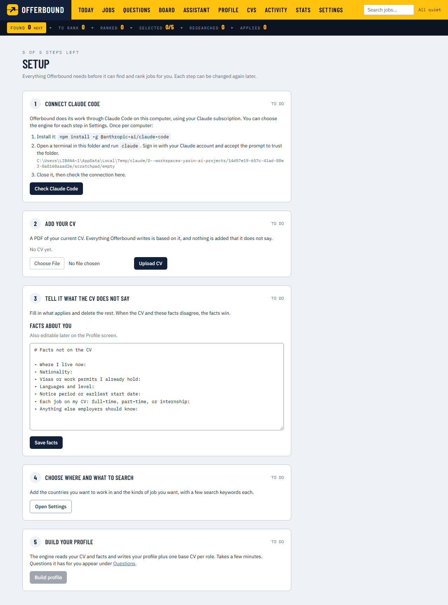
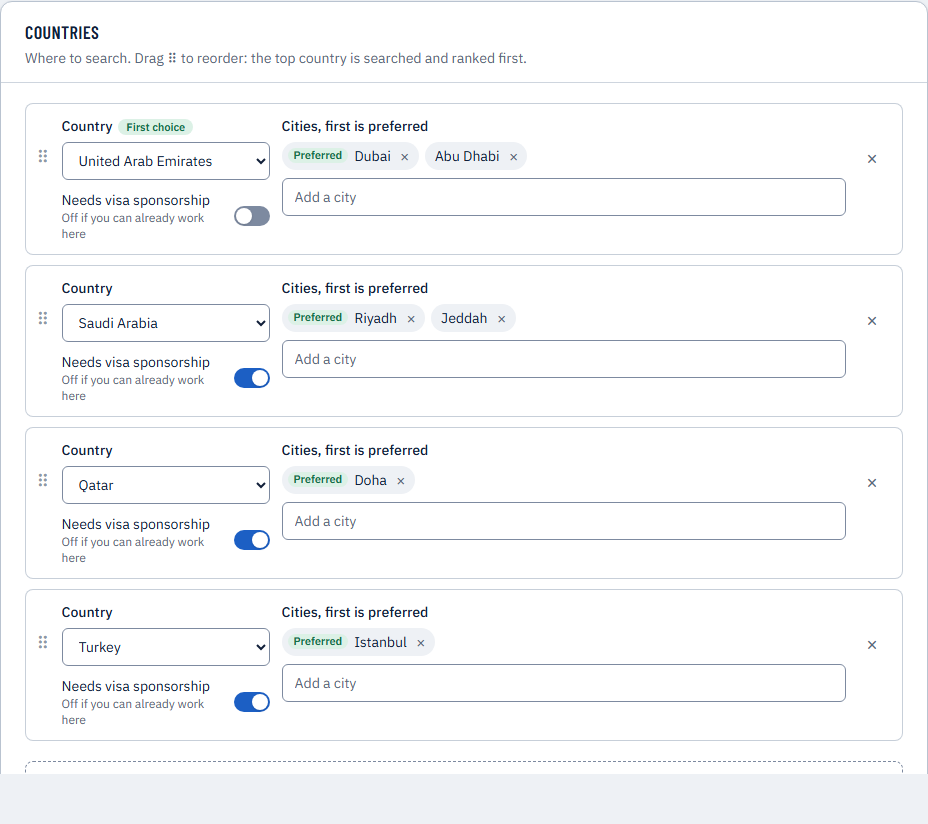
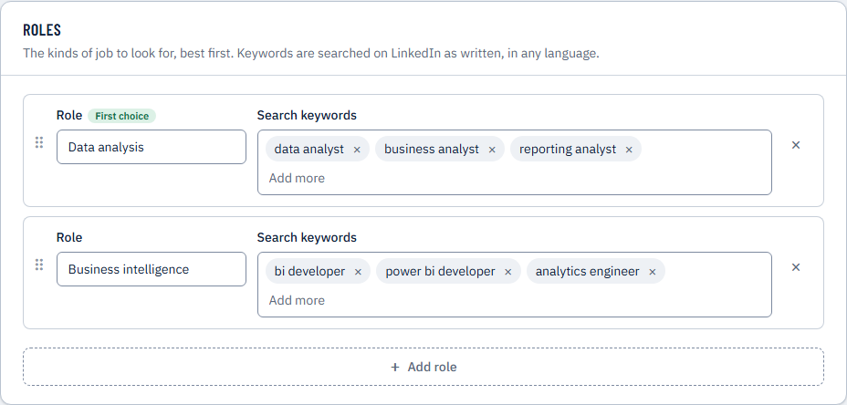
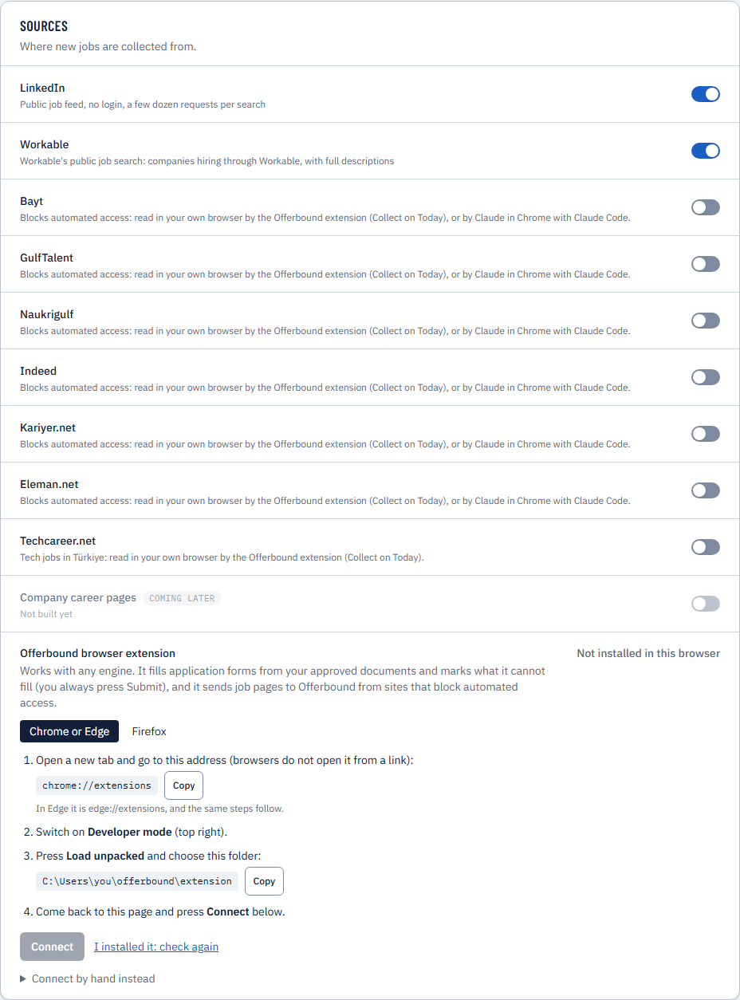
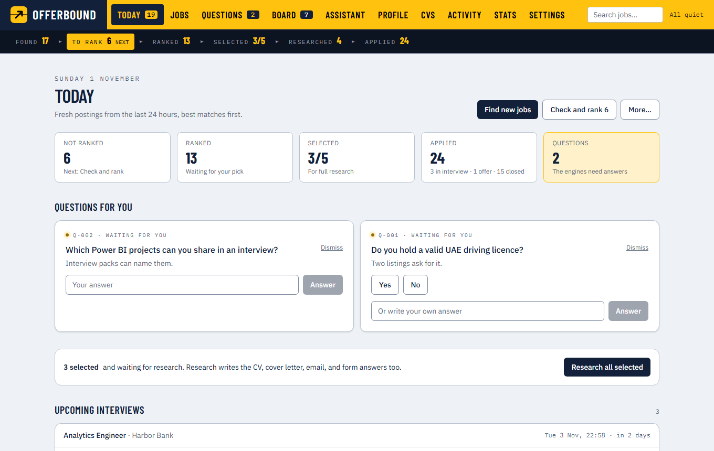
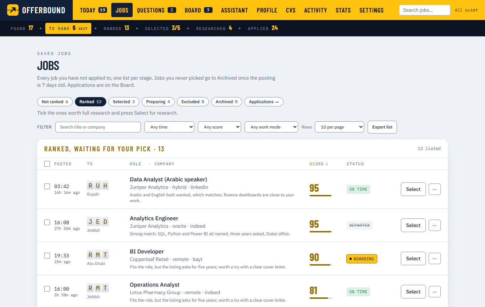
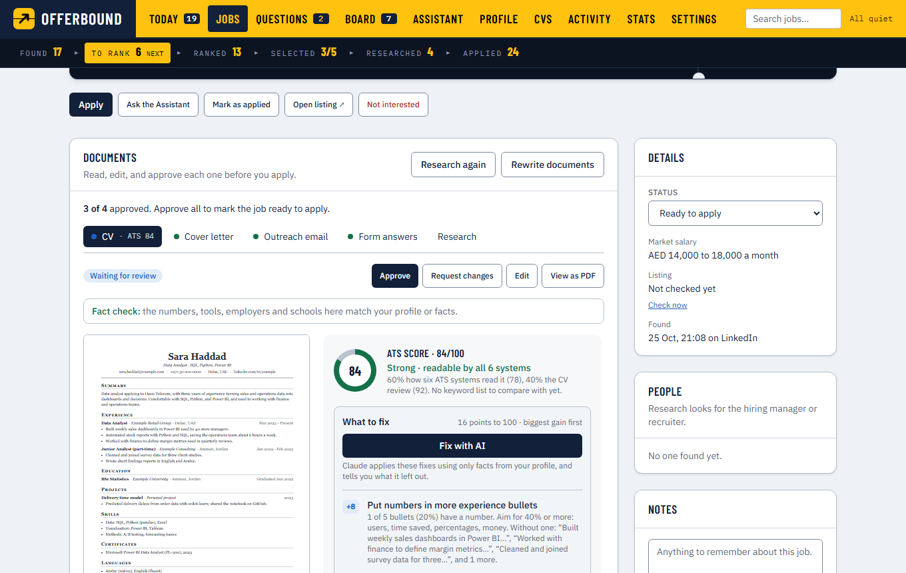
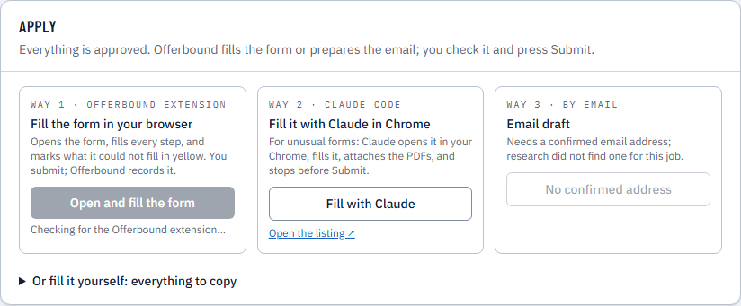
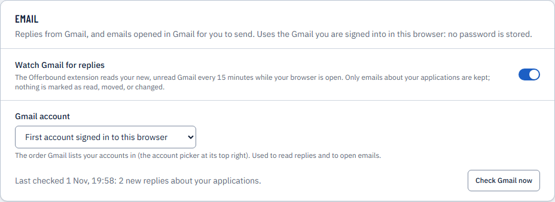
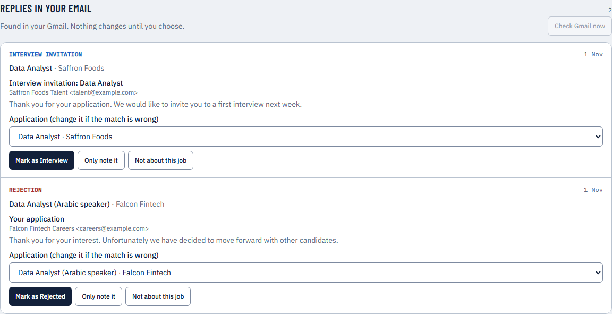

# Getting started with Offerbound

From nothing to your first application, one step at a time. Plan about 30 minutes for the first time; most of it is waiting for installs.

The pictures show a demo with a fictional candidate and fictional companies.

**Contents**

1. [What you need](#1-what-you-need)
2. [Install Node.js](#2-install-nodejs)
3. [Install your AI engine](#3-install-your-ai-engine)
4. [Get Offerbound](#4-get-offerbound)
5. [Install it](#5-install-it)
6. [Let your engine work in the folder](#6-let-your-engine-work-in-the-folder)
7. [Start Offerbound](#7-start-offerbound)
8. [Setup: your CV and facts](#8-setup-your-cv-and-facts)
9. [Where and what to search](#9-where-and-what-to-search)
10. [Build your profile](#10-build-your-profile)
11. [Install the browser extension](#11-install-the-browser-extension)
12. [Find and pick jobs](#12-find-and-pick-jobs)
13. [Research and review the documents](#13-research-and-review-the-documents)
14. [Apply](#14-apply)
15. [After applying](#15-after-applying)
16. [Optional: your phone and the schedule](#16-optional-your-phone-and-the-schedule)
17. [Every day](#17-every-day)
18. [If something does not work](#18-if-something-does-not-work)

---

## 1. What you need

- A computer with Windows, macOS or Linux. Offerbound runs on it; your data stays on it.
- **One** AI plan:
  - a **Claude** subscription (Pro or Max), used through Claude Code, or
  - a **ChatGPT** plan, used through Codex.
- Chrome, Edge or Firefox.
- Your CV as a PDF.

## 2. Install Node.js

Download the **LTS** version from [nodejs.org](https://nodejs.org) and install it with the default options. You need version **22.13 or newer**.

Check it: open a terminal (Windows: *Terminal* or *PowerShell*; macOS: *Terminal*) and run:

```
node --version
```

It should print `v22.13.0` or higher.

## 3. Install your AI engine

In the terminal, install **one** of them:

```
npm install -g @anthropic-ai/claude-code
```

or

```
npm install -g @openai/codex
```

## 4. Get Offerbound

Either:

- with Git: `git clone https://github.com/liban-ali0/offerbound.git offerbound`, or
- download the ZIP from the project's GitHub page (green **Code** button → **Download ZIP**) and unzip it.

Then open a terminal **in the Offerbound folder** (the one with `README.md` in it). On Windows you can right-click the folder in Explorer and choose *Open in Terminal*.

## 5. Install it

```
npm run setup
```

This takes a few minutes. It installs the app and a small browser engine (about 150 MB) that turns your CVs and cover letters into PDFs. It ends by printing a short list of job statuses; that means it worked.

## 6. Let your engine work in the folder

Still in the Offerbound folder, run your engine once:

```
claude
```

(or `codex`). Sign in with your Claude (or ChatGPT) account if asked, and **accept the prompt to trust this folder**. Then leave it: type `/exit` (or press Ctrl+C).

Without this step the engine is not allowed to work in the folder, and every step fails with a message about trust.

## 7. Start Offerbound

```
npm start
```

The first start builds the app (a minute or two). When it prints `Offerbound is starting at http://localhost:3000`, open **http://localhost:3000** in your browser.

Keep that terminal open while you use Offerbound; Ctrl+C stops it. Next time, `npm start` is all you need.

## 8. Setup: your CV and facts

Offerbound opens on **Today** with a *Finish setting up* banner. Press **Open Setup**.



1. **Connect your engine** — press **Check Claude Code**. It answers within a minute.
   *Using Codex?* First go to **Settings → Engines** and choose Codex for the steps; Setup then says Codex.
2. **Add your CV** — choose your CV's PDF and press **Upload CV**.
3. **Facts the CV does not say** — fill in what applies: where you live, nationality, visas or work permits, languages, notice period, and for each job on your CV whether it was full-time, part-time or an internship. Delete the lines that do not apply, then **Save facts**.
   When your CV and these facts disagree, the facts win. Nothing that is not in your CV or these facts is ever written into your applications.

## 9. Where and what to search

Setup step 4 opens **Settings**.

**Countries** — add the countries you want to work in, best first. Drag ⠿ to reorder. Add the cities you prefer, and switch **Needs visa sponsorship** on for countries where you cannot work yet.



**Roles** — the kinds of job you want, best first, each with a few search keywords as job sites write them (in any language, for example `data analyst`, `business analyst`).



While you are there, look at **Experience and work mode** (your level and how many years of experience a job may ask for) and **Freshness** (how new a posting must be; 24 hours is the default because applying early is what works).

Press **Save settings** at the bottom.

## 10. Build your profile

Back on **Setup**, press **Build profile**. The engine reads your CV and facts and writes your profile and one base CV per role. It takes a few minutes; you can follow it on **Activity**.

When it has questions (a missing date, which projects to highlight), they appear under **Questions**. Answer them: every answer is remembered and used in every later application.

## 11. Install the browser extension

The extension fills application forms, reads job sites that block automated access, and (if you want) checks Gmail for replies. It works with either engine.

Go to **Settings → Sources** and follow the steps shown for your browser:



- **Chrome or Edge:** open `chrome://extensions` (Edge: `edge://extensions`), switch on **Developer mode**, press **Load unpacked**, and choose the `extension` folder inside Offerbound (the page shows its exact path with a **Copy** button).
- **Firefox:** open `about:debugging#/runtime/this-firefox`, press **Load Temporary Add-on…**, and choose `manifest.json` in the `extension` folder. Firefox forgets it when it closes, so repeat this after a restart.

Then press **Connect** on that page and confirm in the small window that opens.

In the same section, switch on the job sites you want (LinkedIn and Workable are on by default; Bayt, GulfTalent, Indeed, Kariyer.net and others are read through the extension).

## 12. Find and pick jobs

On **Today**, press **Find new jobs**. Offerbound searches your countries and roles, then ranks every new job against your profile: a score out of 100 and a one-line reason.



Open **Jobs** to see them by stage. On **Ranked**, tick the ones worth your time and press **Select and research** (or **Select only** to research them later).



Status words follow the posting's age: **Boarding** (just posted), **On time**, **Last call**, **Departed**. Jobs you never pick go to **Archived** after a week, so the lists stay short; nothing is ever deleted.

## 13. Research and review the documents

Research looks into the company, the role, the people to contact and the salary, then writes four documents for the job: a **tailored CV**, a **cover letter**, an **outreach email** and **answers** for common form questions. Each job takes a few minutes; they run one after another.

Open the job (from **Today** under *Waiting for your review*, or from the **Board**). For each document:



- Read it. **Edit** opens it in an editor with a live preview.
- The **fact check** lists anything it claims that your CV and facts do not back. Press **This is true** if it is, or **Ask for a rewrite**.
- On the CV, the **ATS score** shows how application systems read it, the biggest fixes, and missing keywords (add only what is true for you). **Fix with AI** applies the fixes using only your real facts.
- When it is right, press **Approve**.

When all four are approved, the job is **Ready to apply**.

## 14. Apply

On a ready job, the **Apply** panel offers three ways. **Offerbound never presses Submit or Send for you.**



1. **Open and fill the form** (the extension) — opens the job's application form, fills every step it can and attaches your CV and cover letter. Fields it could not fill are marked yellow and listed on a bar at the top. Check everything, fill the rest, and press **Submit** yourself. When the site confirms it, the job is marked applied and a copy of what you sent is kept.
2. **Fill with Claude** (Claude Code only) — for unusual forms.
3. **Email draft** — when research found a confirmed email address for the job.

LinkedIn applications are never automated: Offerbound opens the listing and you apply there, with everything ready to copy under *Or fill it yourself*.

## 15. After applying

Everything that needs you appears on **Today** under *Waiting on you*:

- **Follow-ups** after a week without a reply (Settings → Daily selection sets the days), at most two per job. **Write follow-up** drafts a short one.
- **Check-ins** a few days after a reply, and a **thank-you note** reminder after an interview.
- **Gone quiet** after two follow-ups: one click closes it as *No response*.

**Gmail (optional):** in **Settings → Email**, switch on **Watch Gmail for replies**. The extension reads your unread inbox in your browser every 15 minutes (no password, nothing is changed in Gmail) and keeps only emails about your applications.



Replies then appear on **Today**, matched to the application, with the suggested next step. Nothing changes until you press a button.



Record what happens on the job page (*Replied*, *Interview*, *Offer*, *Rejected*). An interview gets an **interview pack**: likely questions with answers from your real experience, and questions to ask them.

## 16. Optional: your phone and the schedule

- **Phone:** **Settings → Other devices** explains how to open Offerbound on your phone with [Tailscale](https://tailscale.com) (free for personal use). Offerbound itself only listens on your computer, so this is the safe way in.
- **Schedule:** **Settings → Schedule** checks for fresh postings every few minutes during the hours you choose and runs a full search once a day, while Offerbound is running.

## 17. Every day

1. `npm start` (if it is not running) and open http://localhost:3000.
2. **Today:** answer questions, handle *Waiting on you* and replies.
3. **Find new jobs** (or let the schedule do it), then pick on **Jobs → Ranked** and **Select and research**.
4. Review and approve documents, then apply.
5. Once a week, look at **Stats → What your applications say**: which kinds of job get answers, and what to change.

## 18. If something does not work

| What you see | What to do |
|---|---|
| `node` is not recognised | Install Node.js (step 2) and open a **new** terminal. |
| A step fails with a message about trusting the folder | Run `claude` (or `codex`) in the Offerbound folder once and accept the prompt (step 6). |
| `Port 3000 is already in use` | Offerbound (or another app) is already running; open http://localhost:3000, or close the other terminal. |
| PDFs fail: *the PDF browser is not installed* | Run `npm run setup` again. |
| Settings → Sources says the extension is not installed | Reload the extension on the browser's extensions page, then press *I installed it: check again*. |
| A job site shows a captcha or *are you a robot* | Open that site yourself once in your browser; Offerbound never tries to get around it. |
| After an update something looks odd | Run `npm run setup`, then `npm start`; it rebuilds itself. |

Your data is in three folders inside Offerbound: `candidate/`, `jobs/` and `data/`. To back up or move to another computer, stop Offerbound and copy them.
